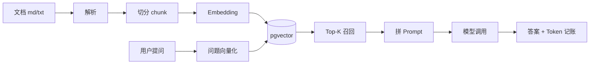

# ms-ai — Spring AI 工程化练习：Chat + RAG 双通道

一个能跑起来的 Spring AI 练习工程，把「大模型接入 → 检索增强 → 工具调用 → 结构化输出 → 流式 → Token 记账」这条链路，用可切换的多通道实做了一遍。

> 定位先说清楚：这是**学习工程**，不是生产脚手架。里面的取舍都为「看得见证据」服务，每个坑都记在文档里。

## 技术栈（版本钉死，改前先查兼容矩阵）

| 组件 | 版本 | 说明 |
| --- | --- | --- |
| Spring Boot | 3.5.16 | Spring AI 1.1.x 要求 3.5.x |
| Spring AI | 1.1.8 | 1.x 主线；2.x 需要 Boot 4.x，不要混 |
| Spring AI Alibaba | 1.1.2.3 | DashScope 原生 starter；其 BOM 不管理 starter 版本，必须显式写 |
| 向量库 | pgvector | 也可切 SimpleVectorStore（内存，重启即丢） |
| JDK | 22 编译 / 17 字节码 | 兼容云机 17 |

## 一次 RAG 问答的链路



## 30 秒跑起来

```bash
# 1. 起 pgvector
docker run -d --name msai-pg -e POSTGRES_PASSWORD=msai123 \
  -e POSTGRES_DB=msai -p 5432:5432 pgvector/pgvector:pg16

# 2. 配 key（别写进 yml，走环境变量）
export DASHSCOPE_KEY=<你的百炼 Key>

# 3. 跑
cd ms-ai && mvn spring-boot:run
# 接口文档：http://localhost:8080/doc.html
```

## 踩过的坑（都是实测）

- **裸 URL 不能直接写进 yml**：没有键名的裸字符串会被 SnakeYAML 当 mapping 解析，遇到 `?` 直接报 `could not find expected ':'`，整个应用起不来。
- **两套 BOM 会打架**：Spring AI 的 BOM 管不到 Alibaba starter，starter 版本必须显式写，否则拉到的版本和核心库对不上。
- **内存向量库重启即丢**：SimpleVectorStore 适合验证链路，正式语料要落 pgvector，或在启动时从 `knowledge/` 自动重灌。

## 已知短板（欢迎直接指出）

- **chunk 策略还是拍的**：目前固定字数切分，没有按语义/标题层级切；chunk 大小对召回的影响**未量化**（待测）。
- **没有召回评估**：缺一套带标注的评测集，Recall@K、命中率这些指标**没量过**（待测）。
- **多轮指代消解没做**：追问「那它呢」这类指代目前靠把历史整段塞进 Prompt，token 浪费且效果不稳。
- **Token 记账只到单次调用**：没有按会话/用户维度聚合，也没有限流与成本上限。

## Roadmap

1. 语义切分 + chunk 大小对照实验，把命中率量出来
2. 建 20 条左右的小评测集，跑 Recall@K 基线
3. Query 改写 / 指代消解
4. 成本与限流：按会话聚合 token，加日限额

## License

MIT
